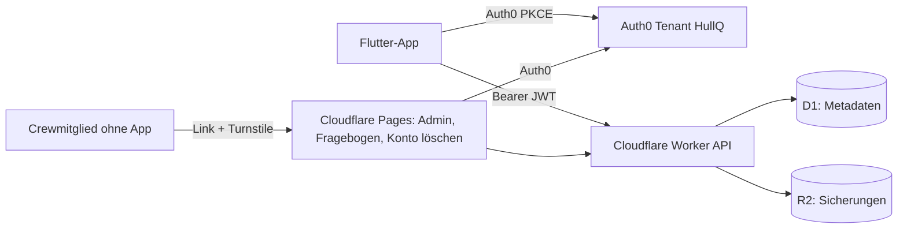

# Planer-Backend – Konzept v0.1

Stand: 26.09.2026 · Entscheidungen des Product Owners: Login über denselben Auth0-Tenant wie HullQ · Backend auf Cloudflare (Workers, D1, R2) · Charterfirmen-Paket mit Admin-Seite in v1

| Version | Datum | Änderung |
| --- | --- | --- |
| v0.1 | 26.09.2026 | Erstfassung: Architektur, Datenmodell, Endpunkte, Sicherheit und Datenschutz, Aufgaben des Product Owners, Slices B0–B5 |

## 1. Ziel und Umfang

Ein schlankes Backend für alles, was die App nicht lokal lösen kann:

| Funktion | Zweck |
| --- | --- |
| Login | Echtes HullQ-Konto statt Attrappe (Google, Apple, E-Mail) |
| Konto löschen | In der App und auf einer Webseite (Pflicht Google Play) |
| Cloud-Sicherung | Sicherung und Wiederherstellung, mehrere eigene Geräte |
| Crew-Fragebogen | Optionaler Link, über den Crewmitglieder ohne App Vorlieben angeben |
| Törn-Codes | Charterfirma gibt Code aus → Freischaltung für den Törn + Voreinstellungen (Basis, Übergabezeit, Proviantservice, Co-Branding) |
| Admin-Seite Charterfirmen | Basen und Proviantservices pflegen, Codes erzeugen, Einlösungen sehen |
| Einwilligung Bootsmarkt-Infos | Einwilligung speichern (Versand über Newsletter-Dienst: offen, siehe 8) |

**Nicht in v1:** Pro-Abo/Bezahlfunktionen (setzt Gewerbe und Händlerkonto voraus), gemeinsame Echtzeit-Listen, Einsicht der Charterfirma in Bestellungen (Bestellungen gehen weiterhin direkt per E-Mail/WhatsApp an den Lieferanten).

## 2. Architektur

- **Repo:** gleiches Repo, neue Ordner `backend/` (Worker, TypeScript strict, Framework Hono, Validierung zod, JWT-Prüfung jose) und `web/` (Cloudflare Pages, Astro + TypeScript, wie HullQ).
- **Tests:** Vitest mit der Cloudflare-Workers-Testumgebung (lokale D1/R2), keine echten Dienste in Tests.
- **Umgebungen:** `dev` (lokal, `wrangler dev`) und `prod`. Deployment führt der Product Owner aus (`wrangler deploy`), nie Gemini.
- **Konfiguration:** `wrangler.toml` ohne Geheimnisse; Geheimnisse ausschließlich über `wrangler secret`. Keine Schlüssel, Tokens oder Client-Secrets im Repo.

## 3. Login mit Auth0 (gleicher Tenant wie HullQ)

- Eigene Auth0-Anwendung "Proviantplaner" (Typ Native) im HullQ-Tenant, eigene API-Audience `https://api.planer.hullq.com` (Platzhalter).
- App: offizielles Paket `auth0_flutter`, Universal Login mit PKCE; Verbindungen Google, Apple (Pflicht bei Google-Login unter iOS), E-Mail/Passwort.
- Worker prüft jedes Token gegen die JWKS des Tenants (Aussteller, Audience, Ablauf).
- **Berechtigungen liegen in D1**, nicht in Auth0 (wie bei HullQ: Auth0 nur Anmeldung). Rolle "Charter-Admin" über Mitgliedschaft in einer Charterfirma.
- Offline bleibt alles nutzbar; Login nur für Sicherung, Freischaltung und Charterfunktionen nötig.

## 4. Datenmodell (D1)

| Tabelle | Wichtige Felder |
| --- | --- |
| `accounts` | id, auth0_sub (eindeutig), created_at, deleted_at |
| `consents` | account_id, type (`boat_market_news`), granted, granted_at, withdrawn_at, text_version |
| `backups` | account_id, device_id, r2_key, size, created_at (neueste 5 je Konto behalten) |
| `crew_forms` | id, token_hash, account_id, trip_ref, expires_at, created_at |
| `crew_answers` | form_id, display_name, vegetarian, no_alcohol, dislikes (Text, max. 200), created_at |
| `charter_orgs` | id, name, display_name, logo_asset (optional), created_at |
| `charter_members` | org_id, account_id, role (`admin`) |
| `charter_bases` | id, org_id, name, marina, handover_time, supplier_name, supplier_email, supplier_whatsapp, notes |
| `trip_code_batches` | id, org_id, base_id, valid_from, valid_to, max_uses_per_code, created_at |
| `trip_codes` | code_hash, batch_id, uses, created_at |
| `trip_code_redemptions` | code_hash, account_id oder device_id, redeemed_at |

- Codes und Formular-Links werden nur als Hash gespeichert; Klartext nur beim Erzeugen angezeigt bzw. exportiert.
- Datenbank mit EU-Speicherort/Jurisdiktion anlegen (Verfügbarkeit bei Einrichtung prüfen).

## 5. Endpunkte (Auswahl)

| Methode | Pfad | Zweck | Auth |
| --- | --- | --- | --- |
| GET | `/v1/me` | Konto, Freischaltstatus, Mitgliedschaften | Nutzer |
| DELETE | `/v1/me` | Konto und alle Daten löschen | Nutzer |
| PUT | `/v1/consents/boat-market-news` | Einwilligung setzen/widerrufen | Nutzer |
| POST/GET | `/v1/backups` | Sicherung hochladen / Liste | Nutzer |
| GET | `/v1/backups/{id}` | Sicherung laden | Nutzer |
| POST | `/v1/crew-forms` | Fragebogen-Link erzeugen | Nutzer |
| GET | `/v1/crew-forms/{id}/answers` | Antworten abrufen | Nutzer (Ersteller) |
| GET/POST | `/v1/public/crew-forms/{token}` | Formular laden / beantworten | öffentlich + Turnstile |
| POST | `/v1/trip-codes/redeem` | Code einlösen → Freischaltung + Voreinstellungen | Nutzer oder Gerät |
| CRUD | `/v1/admin/orgs/{org}/bases` | Basen und Proviantservices | Charter-Admin |
| POST | `/v1/admin/orgs/{org}/code-batches` | Codes erzeugen (CSV-Export einmalig) | Charter-Admin |
| GET | `/v1/admin/orgs/{org}/stats` | Einlösungen je Basis/Zeitraum | Charter-Admin |

## 6. Webseiten (Cloudflare Pages)

- **Crew-Fragebogen** `/f/{token}`: Name, vegetarisch, kein Alkohol, Abneigungen; **keine Gesundheitsdaten** (Hinweis: Allergien bitte direkt mit dem Skipper klären); Turnstile; Sprache nach Browser.
- **Konto löschen** `/konto-loeschen`: Anmeldung über Auth0 → Löschung bestätigen.
- **Admin Charterfirmen** `/admin`: Anmeldung über Auth0; Basen mit Übergabezeit und Proviantservice pflegen; Code-Stapel erzeugen (Gültigkeit, Basis, Anzahl) und als CSV herunterladen; Übersicht der Einlösungen. Design nach HullQ-CI, schlicht.
- Charterfirmen werden in v1 **vom Product Owner manuell angelegt** (kein Selbst-Registrieren).

## 7. Sicherheit und Datenschutz

- Nur HTTPS; CORS nur für eigene Domains; Rate-Limits je IP/Konto; Turnstile für öffentliche Formulare.
- Tokens und Codes mit mindestens 128 Bit Zufall; nur Hash speichern.
- Keine personenbezogenen Daten in Logs.
- **Löschfristen:** Crew-Antworten 30 Tage nach Törnende automatisch (Cron-Trigger); Sicherungen: neueste 5 je Konto; Konto löschen entfernt alle Daten sofort (Sicherungen in R2 inklusive).
- Sicherungen in R2 serverseitig verschlüsselt; Inhalt enthält keine IBANs (Zahlungsdaten bleiben lokal, wie im PRD).
- Keine Gesundheitsdaten in Formularen.

## 8. Offene Punkte

- [ ] Newsletter-Dienst für die Bootsmarkt-Infos mit Double-Opt-in (z. B. Anbieter mit EU-Hosting) – bis dahin nur Einwilligung speichern
- [ ] Domain für API und Webseiten (Unterdomain von HullQ)
- [ ] EU-Jurisdiktion für D1/R2 bei Einrichtung prüfen
- [ ] Texte Datenschutzerklärung, Impressum, Nutzungsbedingungen

## 9. Aufgaben des Product Owners (mit Anleitung durch Claude)

1. Cloudflare-Konto (kostenlos), `wrangler` installieren, D1-Datenbank und R2-Bucket anlegen, Turnstile-Site anlegen
2. Im HullQ-Auth0-Tenant: Anwendung "Proviantplaner" (Native) und API-Audience anlegen; Google- und Apple-Verbindung aktivieren
3. Geheimnisse per `wrangler secret` setzen; Deployment ausführen
4. Erste Charterfirma und ihren Admin anlegen (Skript aus B5)

## 10. Slices

| Slice | Inhalt |
| --- | --- |
| B0 | Backend-Grundgerüst: Worker (Hono, zod, jose), D1-Schema mit Migrationen, R2-Anbindung, Tests, lokale Entwicklung; `web/`-Grundgerüst (Astro) |
| B1 | Login: `auth0_flutter` in der App statt Attrappe, JWT-Prüfung im Worker, `/v1/me`, Einwilligung speichern, Konto löschen (App + Webseite) |
| B2 | Cloud-Sicherung real (R2) statt Attrappe, Wiederherstellung auf neuem Gerät |
| B3 | Crew-Fragebogen: Link erzeugen in der App, Formularseite mit Turnstile, Antworten als Vorschlag übernehmen, automatische Löschung |
| B4 | Törn-Codes: Einlösen in der App (Feature-Schalter an), Freischaltung für den Törn, Voreinstellungen (Basis, Übergabezeit, Proviantservice als Lieferant, Co-Branding) |
| B5 | Admin-Seite Charterfirmen: Basen/Proviantservices, Code-Stapel mit CSV, Einlösungsübersicht; Skript zum Anlegen einer Charterfirma |
