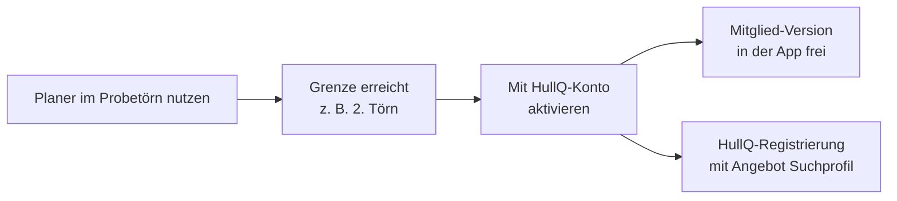

# Proviant- & Bordkassen-Planer – PRD v0.20

Stand: 23.09.2026 · Autor: Gerhard

> Quelle der Wahrheit für die Umsetzung. Das Claude-Doc "Proviantplaner_PRD" ist das Arbeitsdokument; dieser Stand wird bei jeder neuen Version als neue Datei `PRD_vX.Y.md` abgelegt.

> **Vorrang:** Wo dieses PRD und `docs/impl/FEEDBACK_R1_v0.1.md` sich widersprechen, gilt FEEDBACK_R1 (u. a. Listenkonzept, Sichten, Revier, Bordkasse). Die betroffenen Abschnitte werden in einer späteren Fassung neu geschrieben.

## Version & Changelog

Aktuelle Version: v0.20. Lebendes Dokument, Grundlage für die Umsetzung mit Gemini.

| Version | Datum | Änderung |
| --- | --- | --- |
| v0.1 | 23.09.2026 | Erstfassung: Ziel, Plattform nur mobil, Stufen Basis/Mitglied/Pro, HullQ-Konto und Onboarding, Scope für 3–4 Tage |
| v0.2 | 23.09.2026 | Komplett eigenständige App ohne Bootsinhalte, sichtbar "powered by HullQ"; Mitglied-Version wird nur über ein HullQ-Konto aktiviert; Heranführung an die Marktbeobachtung liegt auf HullQ-Seite |
| v0.3 | 23.09.2026 | Anmeldung direkt in der App per HullQ-Login, mit freiwilliger Einwilligung für Bootsmarkt-Infos (HullQ-Mailingliste) |
| v0.4 | 23.09.2026 | Echte Kontofunktionen als Begründung für die Anmeldung (Sicherung, Wiederherstellung, später Teilen mit Crew); Store-Pflichten ergänzt (Sign in with Apple, Konto-Löschung in der App, Datenschutzerklärung); Datenschutz-Grundsatz und Scope angepasst |
| v0.5 | 23.09.2026 | Entscheidungen: Probetörn mit vollem Funktionsumfang und unbegrenzter Crew; Pro als moderates Monats- und Jahresabo; sechs Sprachen (DE, EN, FR, ES, PT, HR); Scope entsprechend angepasst |
| v0.6 | 23.09.2026 | Mengentabelle aus recherchierten Richtwerten (Charter-Provisionierung und Portionsgrößen) mit Anpassungsfaktoren und Quellen |
| v0.7 | 23.09.2026 | Scope-Überschrift und Tagesplan an 5–6 Tage angeglichen (Übersetzung und Store-Einträge als eigene Tage); Grundlage für das Repo proviantplaner |
| v0.8 | 23.09.2026 | Vorratsliste als Kern der App, Menüplan optional (v1.1); Vorratskatalog v0.2; Konsumprofile Essen und Trinken pro Person; Mengen überschreibbar und als Gesamtzahl eingebbar; Einlagerungs-Checkliste; Charter oder eigenes Boot; Scope auf 6–7 Tage |
| v0.9 | 23.09.2026 | Vorratskatalog v0.4 mit Schema Kategorie → Bedarfsgruppe → Variante (Packungsgröße, Haltbarkeit, frisch nachkaufen); Technik auch für Charterer in begrenzter Form; Bordapotheke als Prüfliste |
| v0.10 | 23.09.2026 | Liste zeigt Packungen statt Rechenwerte (Packungsgröße editierbar und gemerkt, +/− je Packung, intelligentes Runden haltbar/frisch, Ausgleich innerhalb der Gruppe); Appetit und Trinken als eine Crew-Frage mit Aufschlag, getrennte Reserve für Ankertage; Einstufung pro Person unter Details |
| v0.11 | 23.09.2026 | B2B-Kanal Charterfirmen: Törn-Code als Partnerprodukt, Liste als Bestellung an den Proviantservice der Basis, Argumente und Timing; beides für v1.1 vorgesehen |
| v0.12 | 23.09.2026 | Bordkasse und Kostenteilung: gemeinsame Kasse und Einzelabrechnung, Ausgabenkategorien, Beteiligung pro Person und Kategorie, Schnellauswahl "Skipper frei", Zahlungen nur anstoßen (Überweisungs-QR nach EPC, PayPal-/Revolut-Links), Splitwise-Export später; Scope 7–8 Tage |
| v0.13 | 23.09.2026 | Android zuerst, iOS später über Cloud-Build; Umsetzung mit Antigravity (Free Tier) im lokalen Repo; Abschnitt "Offen vor dem Start" mit 10 Punkten und Reihenfolge; Start kostenlos, Abo mit v1.1 (Gewerbe und EU-Händlerangaben) |
| v0.14 | 23.09.2026 | Törnverlauf: pro Tag Mittags- und Abends-Restaurant, optional Tagestyp und Hafenname (manuell, keine Logik); Einkaufsstopps und Verteilung von Frischware legt der Nutzer selbst fest; Törnablauf in fünf Phasen, vorgeschlagen statt erzwungen; Navigation mit vier Reitern; Offen-Punkte 1 und 2 erledigt, S1 freigegeben; Katalog v0.5 |
| v0.15 | 23.09.2026 | Umsetzung mit Google AI Pro (Pro-Modell in Antigravity); Katalog v0.6 mit vorläufigen Mengen; S2 bis S6 freigegeben (Mengen und UI vorläufig bis Baseline und Mockups) |
| v0.16 | 24.09.2026 | Nach Review S2: Frisches wird nie automatisch auf spätere Einkäufe verteilt, beim Abrunden nur Rest-Hinweis; Einheitenregel für den Katalog; Katalog v0.7, Quantities v0.4 |
| v0.17 | 26.09.2026 | Feedback-Runde 1 eingearbeitet (vorrangig: docs/impl/FEEDBACK_R1_v0.1.md): leere Liste mit Vorschlägen, eine Liste statt zwei Sichten, Törnlänge bis 180 Tage, Kühlung ab 0 l, 'Wie warm wird es?' statt Revier, Bordkasse mit Kassenwart, Zahlungsdaten je Person; Katalog v0.9, Quantities v0.5 |
| v0.18 | 26.09.2026 | Einkaufsstopp "Liefern lassen" mit Bestellung an Lieferanten (v1); Charterfirmen-Paket mit Törn-Code-Voreinstellungen und voreingestelltem Proviantservice (v1.1); UX maßgeblich nach docs/design/UX_KONZEPT_v0.2.md |
| v0.19 | 26.09.2026 | v1.1 vorgemerkt: Crew-Wünsche per Link (ohne App, braucht Backend); UX maßgeblich nach UX-Konzept v0.5 |
| v0.20 | 26.09.2026 | Charterfirmen-Paket mit Admin-Seite und Crew-Fragebogen per Link in v1 (statt v1.1); Backend auf Cloudflare, Login über HullQ-Auth0 (docs/BACKEND_KONZEPT_v0.1.md) |

## Ziel & Rolle im HullQ-GTM

Der Planer ist eine komplett eigenständige App, die ein echtes Törn-Problem löst, sichtbar "powered by HullQ". In der App gibt es keine Bootsinhalte und keine Marktwerbung: Nutzer wollen die Funktion, nicht den Bootsmarkt. Die Verbindung zu HullQ entsteht an genau einer Stelle, der Aktivierung der Mitglied-Version über ein HullQ-Konto.

**Das Problem:** Eine Crew von 4–8 Leuten, 7–14 Tage, begrenzter Kühlschrank, Einkäufe in Häfen, und am Ende soll die Bordkasse fair aufgehen. Heute läuft das über Zettel, Tabellen und WhatsApp.

**Drei Ziele, in dieser Reihenfolge:**

1. HullQ-Konten gewinnen, im Idealfall mit erstem Suchprofil
2. Ein Werkzeug, das Skipper gern weiterempfehlen und in Foren zeigen
3. Kleine eigene Einnahmen über Pro

**Zielgruppe:** Charter-Skipper und Crews, Eigner auf längeren Törns, Segelschulen. Grundsatz aus dem GTM: Segler schauen immer nach Booten, auch ohne Kaufabsicht.

**Kennzahlen:** Downloads, Anteil mit HullQ-Konto, Anteil mit Suchprofil, Pro-Abschlüsse.

## Plattform & Technik

Nur mobil: eine Flutter-App für Android und iOS aus einer Codebasis, umgesetzt mit Gemini in Antigravity (Google AI Pro, Pro-Modell) im lokalen Repo während der Standzeiten der HullQ-Slices. Android zuerst: Entwicklung und Tests lokal, Start im Play Store. iOS später über einen Cloud-Build-Dienst (z. B. Codemagic), da kein Mac vorhanden ist; Test auf dem iPhone über TestFlight. Sign in with Apple wird erst mit der iOS-Version getestet.

- **Offline zuerst:** Auf dem Boot gibt es oft kein Netz. Alle Planungsdaten liegen lokal auf dem Gerät und funktionieren ohne Verbindung.
- **Lokale Speicherung:** z. B. SQLite über drift oder eine einfache Key-Value-Lösung wie Hive.
- **Online nur für:** Anmeldung mit HullQ-Login, Sicherung der Törns im Konto und Freischaltung von Pro.
- **Zahlungen:** Pro über In-App-Käufe von Apple und Google, z. B. mit RevenueCat, damit keine eigene Abrechnungslogik nötig ist.
- **Store-Kosten:** Apple 99 $ pro Jahr, Google einmalig 25 $.

**Weg von Forum zu App:** Ein Forumslink führt auf eine kleine HullQ-Seite mit den beiden Store-Buttons. Dort steht in einem Satz, was der Planer kann.

**Datenschutz-Grundsatz:** Ohne Konto bleiben alle Daten auf dem Gerät. Mit Konto werden Törns und Bordkasse nur zur Sicherung gespeichert, verschlüsselt übertragen und nie für Marketing oder HullQ-Inhalte ausgewertet. Die Mailingliste hängt allein an der freiwilligen Einwilligung.

## Funktionsumfang: Basis, Mitglied, Pro

Der erste Törn ist ein vollwertiger Probetörn: unbegrenzte Crew und alle Funktionen, auch die von Pro. Wer die App nie in vollem Umfang erlebt, lernt ihre Vorzüge nie kennen. Ab dem zweiten Törn gilt: Mitglied mit HullQ-Login für den Alltag, Pro für Skipper mit vielen Törns.

| Funktion | Probetörn (ohne Konto) | Mitglied (HullQ-Login) | Pro (Abo) |
| --- | --- | --- | --- |
| Anzahl Törns | 1 | unbegrenzt | unbegrenzt |
| Crewgröße | unbegrenzt | unbegrenzt | unbegrenzt |
| Vorratsliste aus dem Katalog | ja | ja | ja |
| Konsumprofile pro Person (Essen, Trinken) | ja | ja | ja |
| Mengen überschreiben, Gesamtzahl eingeben, eigene Positionen | ja | ja | ja |
| Einkaufsliste nach Supermarkt-Abteilung | ja | ja | ja |
| Einlagerungs-Checkliste | ja | ja | ja |
| Essgewohnheiten der Crew (vegetarisch, keine Nuss …) | ja | ja | ja |
| Bordkasse: gemeinsame Kasse oder Einzelabrechnung, Kategorien, Skipper frei, Überweisungs-QR und Zahlungslinks | ja | ja | ja |
| Export Einkaufsliste und Abrechnung (PDF, Teilen) | ja | ja | ja |
| Sicherung, Wiederherstellung, mehrere Geräte | nein (kein Konto) | ja | ja |
| Teilen mit der Crew (ab v1.1) | nein | ja | ja |
| Menüplan, optional (ab v1.1) | ja | ja | ja |
| Mehrere Währungen in der Bordkasse | ja | nein | ja |
| Eigene Rezepte und Mengen speichern | ja | nein | ja |
| Vorlagen aus früheren Törns | entfällt | nein | ja |

**Pro als Abo:** Monatsabo und Jahresabo zu moderaten Preisen, kein Einmalkauf. Einmalkäufe bringen am Anfang Geld, tragen aber langfristig nicht. Das Monatsabo passt zu Charterern, die für einen Törn einen Monat buchen; das Jahresabo zu Skippern und Eignern mit vielen Törns. Konkrete Preise offen, als Orientierung etwa 1,99 € pro Monat und 9,99 € pro Jahr.

**Mengenlogik:** Die Vorratsliste entsteht aus dem Vorratskatalog (`docs/KATALOG_v0.7.md`, `data/catalog_v0.9.json`): Jede Position hat eine Rechenbasis (pro Person und Tag, pro Bordabend, pro Crew und Woche, einmal pro Törn), die mit Crew, Törnlänge, Revier, Bordabenden und den Konsumprofilen der Crewmitglieder verrechnet wird. Werte aus Kreuzfahrt oder Gastronomie lassen sich nicht übertragen; maßgeblich sind Charter-Erfahrungswerte.

## Vorratsliste, Konsumprofile und Einlagerung

Die Vorratsliste ist der Kern der App. An Bord wird selten ein Menüplan gemacht; meist heißt es "5 Personen, eine Woche, wir brauchen sicher Pasta, Tomatensauce, Butter, Milch". Genau das liefert die App in Sekunden, der Menüplan ist optional und folgt in v1.1.

**Vorratskatalog:** 10 Kategorien (Frühstück, Grundnahrung, Saucen und Würzen, Frisches, Süßes und Snacks, Getränke ohne und mit Alkohol, Haushalt, Hygiene, Bord und Technik) gegliedert in Bedarfsgruppen mit konkreten Varianten. Der Bedarf wird pro Gruppe berechnet (z. B. Brot 120 g pro Person und Tag) und auf die gewählten Varianten verteilt (Vollkornbrot, Baguette, Brötchen, Knäckebrot …). Jede Variante hat Packungsgröße und Haltbarkeit; die Haltbarkeit steht als Hinweis an jeder Variante (z. B. Baguette "hält 1 Tag", Knäckebrot "hält 90 Tage"); wann was gekauft wird, entscheidet die Crew über ihre Einkaufsstopps. Details in `docs/KATALOG_v0.7.md`.

**Charter oder eigenes Boot:** Die Technik-Gruppe "Alltag an Bord" (Batterien, Stirnlampe, Powerbank, 12-V-USB-Adapter, Gewebeband, Kabelbinder) ist immer sichtbar. Motor, Elektrik, Rigg und Deck, Reparatur sowie Wasser und Sanitär sind beim Charter eingeklappt und beim eigenen Boot als Prüfliste sichtbar.

**Appetit und Trinken: eine Frage pro Crew.** Beim Anlegen fragt die App nicht jede Person einzeln, sondern die ganze Crew:

| Frage | Antworten | Wirkung |
| --- | --- | --- |
| Wie isst eure Crew? | eher leicht · ganz normal · gut und gern · hungrige Segler | −10 % · 0 · +15 % · +25 % auf alle Lebensmittel |
| Reserve für Ankertage und schlechtes Wetter | aus · an | +10 % nur auf haltbare Vorräte, nicht auf Frisches |
| Wie viel wird an Bord getrunken? | gemütlich · normal · feierfreudig | 0,5 · 1,0 · 1,5 auf Bier, Wein, Spirituosen |
| Wer trinkt keinen Alkohol? | Namen antippen | diese Personen zählen bei Alkohol nicht |

Unter "Details" lässt sich jede Person weiterhin einzeln einstufen (Essen klein, normal, groß; Trinken keiner, wenig, normal, viel). Die meisten Crews kommen mit den Crew-Fragen aus.

**Packungen statt Rechenwerte:** Gerechnet wird im Hintergrund in Gramm und Portionen, auf der Liste steht, was man in den Wagen legt: "Spaghetti: 3 × 500 g", darunter klein "Bedarf ca. 1,3 kg, +200 g Reserve".

- Mit + und − wird die Packungszahl direkt geändert; das ist zugleich die Überschreibung. Überschriebene Mengen werden markiert und bleiben stehen, auch wenn sich Crew oder Tage ändern; "Zurücksetzen" holt den berechneten Wert zurück.
- Weicht die Packungsgröße im Laden ab, wird sie einmal geändert; die App rechnet neu und merkt sich die Größe für künftige Törns.
- **Intelligentes Runden:** Haltbares (ab 14 Tagen Haltbarkeit) wird immer aufgerundet. Frisches wird nur aufgerundet, wenn der Überschuss höchstens ein Viertel einer Packung beträgt, sonst abgerundet mit dem Hinweis "Rest ca. X – bei einem Einkaufsstopp einplanen". Die App verteilt Frisches nie automatisch auf spätere Einkäufe.
- **Ausgleich in der Gruppe:** Rundet eine Variante stark auf, wird bei einer anderen Variante derselben Gruppe eher abgerundet, damit die Gruppe insgesamt nah am Bedarf bleibt.
- Positionen lassen sich abwählen und eigene hinzufügen.

**Einlagerungs-Checkliste:** Nach dem Einkauf wird die Liste zur Checkliste fürs Verstauen, mit Hinweisen pro Position:

- Kartons an Land auspacken, nicht an Bord nehmen (Ungeziefer und Eier reisen in Wellpappe mit)
- Obst und Gemüse waschen, z. B. in Essigwasser, und gut trocknen; Kartoffeln trocken und dunkel, getrennt von Zwiebeln
- Etiketten von Dosen entfernen, Inhalt mit wasserfestem Stift auf den Deckel schreiben
- Eier kühl und dunkel lagern, ungekühlte Eier regelmäßig wenden
- Fleisch und Fisch sofort in den Kühlschrank und zuerst verbrauchen

In warmen Revieren (Karibik, Tropen) ist die Checkliste standardmäßig aktiv, sonst optional.

**Ernährungs-Tags** (Fleisch, Fisch, Milch, Ei, Gluten, Nüsse, Alkohol) dienen nur zum Filtern und sind kein Allergieschutz; die App weist darauf hin, Zutaten auf der Packung zu prüfen.

## Mengentabelle (recherchierte Richtwerte)

Die App rechnet mit Standardwerten pro erwachsener Person, die der Nutzer anpassen kann. Grundlage sind Charter-Provisionierungsleitfäden und gängige Portionsrichtwerte; alle Werte sind Startwerte, keine Ernährungsempfehlung. Maschinenlesbar in `data/quantities_v0.2.json`.

### Trinkwasser pro Person und Tag

| Revier | Standardwert |
| --- | --- |
| gemäßigt, Nord- und Ostsee | 1,5–2 l |
| Mittelmeer im Sommer | 2–3 l |
| heiß oder abgelegen (Karibik, Tropen) | 3–4 l |

Kochwasser kommt meist aus dem Bordtank und wird nicht mitgerechnet.

### Hauptmahlzeit an Bord, pro Person

| Zutat | Menge | Hinweis |
| --- | --- | --- |
| Fleisch ohne Knochen | 150–200 g roh | mit Knochen 200–250 g |
| Hackfleisch, Gulasch, Bolognese | 100–120 g roh | |
| Fischfilet | 150–180 g | ganzer Fisch ca. 300 g |
| Nudeln als Hauptgericht | 120–150 g trocken | als Beilage 50–80 g |
| Reis | 60–80 g trocken | |
| Kartoffeln | 200–250 g | |
| Gemüse | 150–200 g als Beilage | als Hauptgericht ca. 400 g |

### Frühstück und Grundvorrat, pro Person und Woche

| Artikel | Menge pro Woche |
| --- | --- |
| Eier | 12 Stück |
| Käse gemischt | 250 g |
| Aufschnitt, Schinken, Salami | 200 g |
| Butter | 125 g |
| Milch | 0,5 l |
| Brot | ein halber Laib plus täglich frisches Brot vor Ort |
| Obst gemischt | 1,5 kg |
| Gemüse und Salat für Mittagessen | 1 kg, frisch nachkaufen |
| Olivenöl | 1 l pro Crew |

### Anpassungsfaktoren

- **Appetit:** ersetzt durch die Konsumprofile pro Person (siehe oben)
- **Bordmahlzeiten statt Restaurant:** Pro Tag Schalter Mittags und Abends Restaurant; nur Bordmahlzeiten zählen
- **Frische zuerst:** Verderbliches für die ersten 2–3 Tage, danach Nachkauf in Häfen
- **Kühlschrank als Grenze:** Warnung, wenn die frischen Mengen die angegebene Kühlkapazität übersteigen (Monorumpf oft 60–120 l, Katamaran 100–200 l)
- **Urlaubseffekt:** Im Urlaub wird mehr gesnackt und mehr getrunken als zu Hause; Snacks und Getränke erhöht ansetzen

### Getränke

Getränke machen typischerweise einen großen Teil des Budgets aus. Bier, Wein und Spirituosen werden mit einstellbaren Startwerten pro erwachsener Person und Abend berechnet und über das Trinkprofil angepasst; die Crew kann jederzeit eine Gesamtzahl eintragen.

### Quellen

- [SAIL Magazine: Charter Provisioning Tips](https://sailmagazine.com/charter/charter-provisioning-tips/)
- [Navigare Yachting: Charter-Provisionierung](https://navigare-yachting.com/en/blog/sailing-tips/plan-your-charter-boat-provisioning-like-a-pro)
- [Yachting World: Provisioning Special Report](https://www.yachtingworld.com/sailing-across-atlantic/provisioning-special-report-98185)
- [SavvySalt: How To Provision](https://savvysalt.com/blog/how-to-provision/)
- [boat4you: Provisioning a Charter Yacht](https://www.boat4you.com/blog/provisioning-a-charter-yacht-galley-and-food-guide)
- [Sailoe: Boat provisioning](https://www.sailoe.com/en/boat-provisioning/)
- [AI Chef Pro: Portionsgrößen-Tabelle Gastronomie](https://aichef.pro/de/blog/portionsgroessen-tabelle)
- [EDEKA: Portionsgrößen](https://www.edeka.de/ernaehrung/bewusste-ernaehrung/portionsgroessen.jsp)
- [alacarte-kurier: Portionsgrößen](https://alacarte-kurier.de/die-richtigen-portionsgroessen-finden-ohne-dabei-raten-zu-muessen/)
- [rechner-portal: Nudeln pro Person](https://rechner-portal.de/kochen-ernaehrung/rezepte-portionen/nudeln-pro-person)

## Törnverlauf und Ablauf

Die App plant keine Route und entscheidet nicht, wo eingekauft wird. Das legt die Crew selbst fest; die App rechnet nur.

**Pro Tag (Tagesleiste):**

- Schalter **Mittags Restaurant** und **Abends Restaurant**; daraus ergeben sich die Bordmahlzeiten (Mittag und Abend)
- **Optional, manuell:** Tagestyp (Marina, Hafen, Ankerbucht, Überfahrt) und Hafenname, rein zur Orientierung, ohne Rechenlogik

**Einkaufsstopps:** Die Crew legt Stopps selbst an, z. B. "Einkauf Tag 1 (Basis)" oder "Einkauf Tag 4, Supermarkt Hvar". Anzahl und Zeitpunkt entscheidet allein die Crew.

- Die App zeigt den Gesamtbedarf; der Nutzer verschiebt Positionen oder Teilmengen auf einen Stopp (z. B. 2 von 5 Baguettes auf Tag 4)
- Nicht zugeordnete Mengen gehören zum ersten Einkauf
- Jeder Stopp hat eine eigene Einkaufsliste, nach Abteilung sortiert und abhakbar
- Die Haltbarkeit bleibt an jeder Variante sichtbar (z. B. "hält 1 Tag"); die App gibt Informationen, trifft aber keine Entscheidung

**Ablauf in fünf Phasen,** die App schlägt die passende Ansicht vor, sperrt aber nichts:

1. **Planen:** Törn anlegen, Crew, Crew-Fragen, Liste prüfen, Einkaufsstopps anlegen, Einzahlung in die Bordkasse vereinbaren
2. **Einkaufen:** Liste des jeweiligen Stopps abhaken, Einkauf als Ausgabe erfassen
3. **Einlagern:** Einlagerungs-Checkliste
4. **Unterwegs:** Tagesübersicht, nächster Einkaufsstopp mit Liste, Ausgaben erfassen
5. **Abschluss:** Bordkasse abschließen, Salden, Überweisungs-QR-Codes, Törn archivieren

**Navigation:** vier Reiter unten: Liste, Törn (Tagesleiste und Stopps), Bordkasse, Mehr.

**Später, nicht in v1:** laufender Vorratsbestand ("was ist noch da") und Crewwechsel während des Törns.

## Bordkasse und Kostenteilung

Die App rechnet und stößt Zahlungen an, wickelt aber selbst kein Geld ab. Damit gibt es keine Zahlungsabwicklung, keine Finanzregulierung und keine Gebühren.

**Zwei Kassenmodelle, beide an Bord gelebte Praxis:**

| Modell | Ablauf |
| --- | --- |
| Gemeinsame Bordkasse (Standard) | Jeder zahlt zu Beginn einen Betrag ein; aus der Kasse werden Einkäufe, Hafen, Diesel usw. bezahlt; am Ende wird der Rest verteilt oder nachgeschossen |
| Einzelabrechnung | Jeder erfasst, was er bezahlt hat; die App rechnet "wer schuldet wem" mit möglichst wenigen Überweisungen |

**Ausgabenkategorien:** Proviant, Getränke, Hafen und Liegeplatz, Diesel, Charter und Kaution, Restaurant, Sonstiges. Jede Ausgabe bekommt eine Kategorie.

**Beteiligung pro Person und Kategorie:** Für jede Person lässt sich festlegen, an welchen Kategorien sie sich beteiligt. Ihr Anteil wird auf die übrigen Beteiligten verteilt.

- **Schnellauswahl "Skipper frei":** ganz frei, oder nur frei bei Charter, Hafen und Diesel, während Essen und Getränke selbst bezahlt werden
- Dasselbe Prinzip für andere Fälle, z. B. wer keinen Alkohol trinkt, zahlt bei Getränken mit Alkohol nicht mit
- Einzelne Ausgaben können zusätzlich abweichend aufgeteilt werden

**Zahlungen anstoßen, nicht abwickeln:**

- **Überweisungs-QR-Code (EPC-QR, GiroCode):** Aus IBAN, Name und Betrag erzeugt die App einen QR-Code, den gängige europäische Banking-Apps scannen; die Überweisung ist vorausgefüllt
- **Zahlungslinks:** Wer PayPal oder Revolut nutzt, hinterlegt seinen Link; die App ergänzt den Betrag, soweit der Dienst das unterstützt
- IBAN und Links werden nur lokal gespeichert und nur auf Wunsch geteilt
- **Später:** Export der Ausgaben zu Splitwise über dessen offizielle Schnittstelle

Venmo wird nicht unterstützt, da es praktisch nur in den USA verfügbar ist.

**Mehrere Währungen:** im Probetörn und in Pro, mit einer vom Nutzer eingegebenen oder abgerufenen Umrechnung und einer Abrechnungswährung für den ganzen Törn.

## Lieferanten: Liefern lassen (v1)

Ein Einkaufsstopp kann "selbst einkaufen" oder "liefern lassen" sein. Bei "liefern lassen" erzeugt die App eine Bestellung (Kopf mit Boot, Marina, Liegeplatz, Lieferzeit, Ansprechpartner; Positionen nach Abteilung mit Menge und Packungsgröße) und versendet sie per E-Mail mit PDF, WhatsApp oder als PDF. Lieferanten werden gespeichert und wiederverwendet. Bei Lieferung werden Positionen abgehakt, Fehlendes auf einen anderen Stopp verschoben. Keine Zahlungsabwicklung; die Rechnung wird als Ausgabe erfasst. Details: `docs/design/UX_KONZEPT_v0.2.md` Abschnitt 2.4a.

## B2B-Kanal: Charterfirmen

Die App trägt sich auch eigenständig, und Charterfirmen sind der stärkste Vertriebskanal: Eine Firma bringt pro Saison Hunderte Crews, ohne dass jede einzeln gewonnen werden muss.

**Törn-Code (Partnerprodukt):** Die Charterfirma erhält Codes, die für die Dauer eines Törns alle Funktionen inklusive Pro freischalten, und verschickt sie mit der Buchungsbestätigung. Modell zu testen: bezahlte Codes zu einem kleinen Preis pro Buchung oder kostenlos als Reichweite. Eingelöste Codes werden der Firma zugeordnet, damit sie den Nutzen sieht.

**Anbindung an den Proviantservice der Basis:** Viele Basen verkaufen eigene Proviantpakete; eine Einkaufs-App kann für sie wie Konkurrenz wirken. Deshalb kann die Crew die fertige Liste direkt als Bestellung an den Proviantservice ihrer Basis senden (zunächst als strukturierte E-Mail oder PDF im Format der Basis). So verkauft die Basis mehr statt weniger.

**Argumente für die Basis:**

- Crews starten besser vorbereitet, weniger Stress bei der Übergabe
- Einlagerungs-Checkliste hilft gegen Ungeziefer an Bord und damit gegen echte Kosten für die Flotte
- Service mit eigenem Namen, ohne eigene Entwicklung
- Proviantbestellungen kommen vollständiger und früher

**Timing:** Charterfirmen planen die nächste Saison meist im Winter; Ansprache daher im Winter nach dem Store-Launch. Gleiche Ansprechpartner wie für die spätere Charter-Übergabe-App.

**Charterfirmen-Paket (v1.1):** Der Törn-Code übernimmt Basis, Übergabezeit und den Proviantservice der Basis als voreingestellten Lieferanten, zeigt ein dezentes Co-Branding und schaltet alle Funktionen für den Törn frei. Die Bestellfunktion selbst ist bereits Teil von v1 ("Liefern lassen"). Eine Web-Übersicht für Charterfirmen (eingelöste Codes, Bestellungen) gehört zum HullQ-Backend und folgt später.

## Aktivierung über HullQ

Die App bleibt frei von Bootsinhalten. Die einzige Verbindung zu HullQ ist die Aktivierung der Mitglied-Version, und die Heranführung an die Marktbeobachtung passiert auf HullQ-Seite, nicht in der App.

- **In der App:** Ein Button "Kostenlos freischalten mit HullQ-Login" plus dezentes "powered by HullQ". Sonst nichts von HullQ.
- **Anmeldung:** mit dem HullQ-Login direkt in der App (E-Mail oder Sign in with Apple/Google). Die App bekommt nur ein Token mit dem Status "Mitglied", keine eigene Nutzerverwaltung.
- **Einwilligung beim Login:** eine Checkbox "Ja, ich möchte über den aktuellen Bootsmarkt informiert werden", nicht vorausgewählt. Zustimmung führt auf die HullQ-Mailingliste, mit Bestätigungsmail.
- **Auf HullQ-Seite:** Mailingliste, Suchprofil-Angebot, Watchlist und Alerts. Nichts davon in der App.
- **Kein Gebimmel:** Keine Push-Nachrichten und keine Bootsvorschläge aus der App heraus.

**Schnittstelle zu HullQ (vorab festlegen):**

- Aktivierungs-Endpunkt: Login mit HullQ-Konto, Rückgabe eines Tokens mit Mitglied-Status
- Prüfung des Status beim App-Start, offline tolerant (einmal aktiviert, bleibt aktiv)
- Kennzeichnung der Registrierungsquelle "Planer", damit HullQ die Wirkung messen kann

**Warum die Anmeldung einen echten Nutzen braucht:** Apple lässt eine Registrierungspflicht nur zu, wenn das Konto für die Funktion relevant ist. Eine reine Sperre, damit sich jemand anmeldet, kann als Datensammlung gewertet werden und die Freigabe kosten. Deshalb bringt das Konto in der App Sicherung, Wiederherstellung und die Nutzung auf mehreren Geräten, ab v1.1 auch das Teilen mit der Crew.

### Store-Pflichten

| Pflicht | Store | Umsetzung |
| --- | --- | --- |
| Sign in with Apple, sobald Google-Login angeboten wird | Apple | als gleichwertige Option neben E-Mail und Google |
| Konto direkt in der App löschen können | Apple | Menüpunkt "Konto löschen", löscht HullQ-Konto und gesicherte Törns |
| Konto-Löschung auch außerhalb der App anfordern können | Google | Webseite auf HullQ mit Löschanfrage, im Play-Eintrag verlinkt |
| Datenschutzerklärung | Apple, Google | eigene Seite auf HullQ, in App und Store-Eintrag verlinkt |
| Angaben zur Datennutzung | Apple, Google | App Privacy (Apple) und Datensicherheit (Google) ausfüllen, passend zum Datenschutz-Grundsatz |
| Mailingliste nur mit Einwilligung | EU-Recht | Checkbox nicht vorausgewählt, Bestätigungsmail |

## Scope der ersten Version

Die erste Version umfasst Probetörn und Mitglied mit Vorratsliste, Einlagerungs-Checkliste, Bordkasse, Anmeldung, Sicherung und sechs Sprachen. Mit Store-Pflichten, Übersetzung und der erweiterten Bordkasse sind 7–8 Tage realistisch. Pro-Abo und Menüplan folgen in v1.1.

| Tag | Inhalt |
| --- | --- |
| 1 | App-Gerüst, lokale Datenhaltung, Törn anlegen mit Crew-Profilen und "Charter oder eigenes Boot" |
| 2 | Vorratskatalog und Mengen-Engine, Vorratsliste nach Abteilung mit Überschreiben und eigenen Positionen |
| 3 | Einlagerungs-Checkliste, Bordkasse mit beiden Kassenmodellen, Kategorien, Skipper frei und Überweisungs-QR (bei Bedarf eineinhalb Tage) |
| 4 | HullQ-Login mit Einwilligungs-Checkbox, Freischaltung Mitglied, Sicherung und Wiederherstellung, Konto löschen, Export |
| 5 | Übersetzung in sechs Sprachen, Formate für Einheiten, Datum und Währung |
| 6 | Tests auf echten Geräten, Store-Einträge in sechs Sprachen, Review der Anmeldung |
| 7 | Puffer für Nachbesserungen aus der Store-Prüfung |

**Bewusst ausgeklammert für v1:**

- Pro-Abo über In-App-Käufe (Monat und Jahr), geplant für v1.1
- Menüplan (optional), geplant für v1.1
- Teilen mit der Crew, geplant für v1.1
- Törn-Code für Charterfirmen, geplant für v1.1
- Splitwise-Export, später
- Rezeptdatenbank

**Sechs Sprachen (DE, EN, FR, ES, PT, HR):** Übersetzung der Oberfläche über Flutter-Sprachdateien (ARB), Entwurf per KI, danach Stichprobe durch Muttersprachler. Mitzudenken sind Lebensmittelnamen, Supermarkt-Abteilungen, Maßeinheiten, Datums- und Währungsformate sowie die Store-Einträge in allen sechs Sprachen. Aufwand etwa ein zusätzlicher Tag.

Apple prüft neue Apps meist innerhalb weniger Tage, kann aber Nachbesserungen verlangen. Deshalb ist Tag 7 Puffer und kein Feature-Tag.

## Offen vor dem Start

| Nr | Punkt | Warum | Reihenfolge |
| --- | --- | --- | --- |
| 1 | Törnverlauf mit Hafen-, Anker- und Marinatagen | macht "unterwegs frisch nachkaufen" erst nützlich; betrifft das Datenmodell (S1) | zuerst |
| 2 | Ablauf eines Törns: Planen, Einkaufen, Einlagern, Unterwegs, Abrechnen (inkl. Abschluss der Bordkasse) | betrifft Datenmodell und Navigation | zuerst |
| 3 | Kernbildschirme als Mockups (Stitch), im Repo abgelegt | ohne Vorlage rät Gemini beim Layout | danach |
| 4 | App-Name, Icon, Farben, Sichtbarkeit von "powered by HullQ" | ab S0 gebraucht | danach |
| 5 | Übersetzung des Katalogs (212 Varianten) in sechs Sprachen: KI-Entwurf plus Stichprobe | Pflicht für sechs Sprachen | vor S9 |
| 6 | Schnittstelle zum HullQ-Login beschreiben (nicht bauen) | Mock in der App entspricht dem späteren Original | vor S7 |
| 7 | Datenschutzerklärung, Impressum, später Nutzungsbedingungen für das Abo | Store-Pflicht; für bezahlte Apps Gewerbe und EU-Händlerangaben nötig | vor S10 |
| 8 | Absturzberichte datenschutzfreundlich einbauen: bewusste Entscheidung | Fehler bei Nutzern sichtbar machen | vor S10 |
| 9 | Testphase: echter Törn mit Testcrew über den internen Test im Play Store | Praxis vor Öffentlichkeit | nach S10 |
| 10 | Store-Auftritt: Beschreibung, Stichwörter, Screenshots in sechs Sprachen | Auffindbarkeit | vor Launch |

**Start kostenlos, Abo mit v1.1:** Bezahlte Angebote im Play Store setzen ein Gewerbe und öffentliche EU-Händlerangaben voraus. Deshalb startet die App kostenlos (Probetörn und Mitglied), das Pro-Abo folgt nach der Gewerbeanmeldung.

**Freigabe für Gemini:** S0 bis S6 sind freigegeben. Mengen sind vorläufig (Baseline folgt), die Oberfläche ist vorläufig, bis die Mockups vorliegen; beides muss später ohne Umbau anpassbar sein.

## Offene Fragen

- [ ] App-Name finden (eigener Name, ergänzt um "powered by HullQ")
- [x] Pro als Monats- und Jahresabo
- [ ] Konkrete Abo-Preise festlegen
- [x] Probetörn: 1 Törn, unbegrenzte Crew, alle Funktionen
- [ ] Mengentabelle auf Plausibilität prüfen und nach dem ersten echten Törn nachjustieren
- [ ] HullQ-API: Aktivierungs-Endpunkt rechtzeitig bereit?
- [x] Sprachen: Deutsch, Englisch, Französisch, Spanisch, Portugiesisch, Kroatisch
- [ ] Muttersprachler für die Stichprobe der Übersetzungen finden
- [ ] Baseline der Mengen klären: Startwerte der Konsumprofile und der geschätzten Katalogmengen kalibrieren
