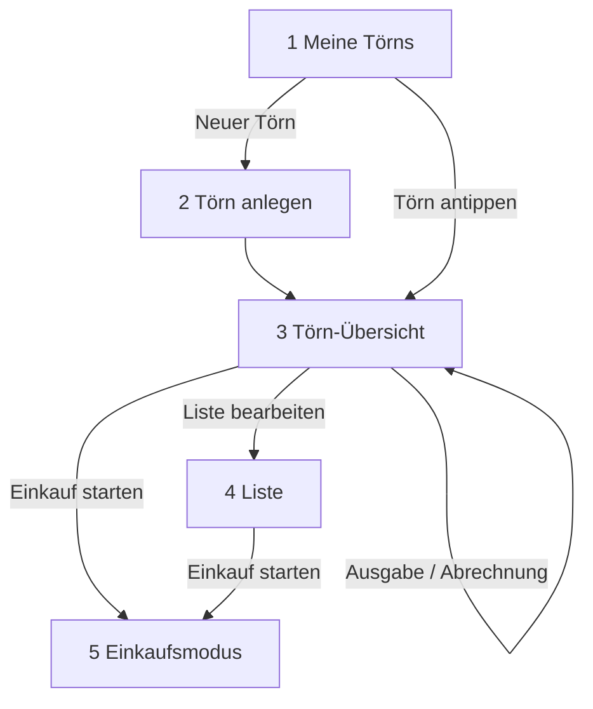

# UX-Konzept v0.2 – radikal vereinfacht

Stand: 26.09.2026 · Grundlage: Praxistests des Product Owners (Feedback-Runden 1 und 2), PRD v0.17 · **Ersetzt die Informationsarchitektur und die Bildschirmliste des Design-Briefs v0.5.** Tokens, Farben, Schriften, Nachtwache, Barrierefreiheit und Texte aus dem Design-Brief bleiben gültig.

| Version | Datum | Änderung |
| --- | --- | --- |
| v0.1 | 26.09.2026 | Erstfassung: Ablauf als Rückgrat, fünf Hauptbildschirme, Bedienmuster, Bewegung, eingearbeitete Punkte aus FEEDBACK_R2, Platzhalter für v1.1 |
| v0.2 | 26.09.2026 | Einkaufsstopp-Art "Liefern lassen" mit Bestellung an Lieferanten (v1); Charterfirmen-Paket als Platzhalter (v1.1) |

## 1. Leitgedanke

Der Nutzer denkt in einem einfachen Ablauf:

**Törn anlegen → Liste erstellen → Einkaufen (ein oder mehrere Stopps) → Törn abschließen und abrechnen**

Die App bildet genau diesen Ablauf ab. Keine Reiterleiste, keine verschachtelten Untermenüs. Alles, was man in einem normalen Törn braucht, ist höchstens zwei Tipps entfernt.

**Fünf Regeln:**

1. **Höchstens fünf Hauptbildschirme.** Alles andere passiert dort, wo es gebraucht wird.
2. **Aufklappen statt Wegnavigieren.** Details öffnen sich an Ort und Stelle (aufklappbare Bereiche, Inline-Bearbeitung). Bottom Sheets nur für kurze Eingaben (höchstens drei Felder).
3. **Hauptaktionen sind sichtbar.** Nie im Drei-Punkte-Menü. Dort nur Seltenes: Umbenennen, Duplizieren, Archivieren, Löschen.
4. **Die App schlägt vor, die Crew entscheidet.** Vorschläge sind als Vorschläge erkennbar; nichts wird aufgedrängt, gesperrt oder bewertet.
5. **Bewegung erklärt.** Animationen zeigen, woher etwas kommt und wohin es geht; nie Dekoration.

## 2. Die fünf Hauptbildschirme

Bordkasse und Abrechnung sind **Teil der Törn-Übersicht** (aufklappbarer Bereich bzw. Vollbild-Sheet), kein eigener Bereich mit Untermenüs.

### 2.1 Meine Törns

- Karten der Törns: Name, Datum, Personen, aktueller Schritt im Ablauf ("Nächster Schritt: Einkaufen")
- Großer Button unten: **"Neuer Törn"**
- Archiv als eingeklappter Bereich am Ende
- Oben rechts: Symbol für Einstellungen (Konto, Darstellung inkl. Nachtwache, Sprache, Meine Zahlungsdaten, Rechtliches)
- Keine Reiterleiste

### 2.2 Törn anlegen – ein Bildschirm, drei Abschnitte

Kein mehrstufiger Assistent, sondern **ein** scrollbarer Bildschirm mit drei Abschnitten, die sich nacheinander aufklappen (der nächste öffnet sich weich, wenn der vorige ausgefüllt ist):

1. **Törn:** Name, Startdatum, Dauer (Zahlenfeld 1–180 Tage mit Schnellwahl 1 Woche · 2 Wochen · 1 Monat · 3 Monate · 6 Monate), Charter oder eigenes Boot
2. **Crew:** Personen als Chips-Zeilen (Name, Kind, vegetarisch, kein Alkohol, Skipper); "+ Person"; Zahlungsdaten optional später
3. **Essen an Bord:**
   - "Wie isst eure Crew?" (eher leicht · normal · gut und gern · hungrige Segler)
   - "Esst ihr auch auswärts?" Nein / Ja → zwei Zähler: "Abendessen im Restaurant: 2 von 7", "Mittagessen im Restaurant: 1 von 7"
   - Kühlschrank: Zahlenfeld in Litern (Standard leer = unbekannt) oder Schalter "kein Kühlschrank"
   - "Reserve für Ankertage" (+10 % auf Haltbares)

Unten fix: **"Törn anlegen"** → führt direkt zur Törn-Übersicht.

**Entfällt:** Revier und Klimazone (Wasser wird auf der Liste angepasst), Einrumpf/Katamaran, Tagesleiste als Pflicht, Trinkfrage im Setup (Alkohol wird auf der Liste wie jede Position übernommen oder nicht; Nicht-Trinker über den Crew-Chip).

### 2.3 Törn-Übersicht – das Rückgrat

Kopf: Törnname, Datum, "5 Personen · 7 Tage", Symbol "Bearbeiten" (öffnet dieselben drei Abschnitte wie beim Anlegen).

Darunter **der Ablauf als vier Schritte**, als Karten untereinander, verbunden durch eine feine gestrichelte Linie:

| Schritt | Karte zeigt | Hauptaktion |
| --- | --- | --- |
| 1 Liste | "34 Positionen · 12 Vorschläge offen" | **"Liste bearbeiten"** |
| 2 Einkaufen | eine Zeile je Einkaufsstopp mit Art-Symbol: "Tag 1 · Basis · 18 Posten" (selbst einkaufen), "Tag 1 · Proviantservice Basis · bestellt" (liefern lassen); "+ Einkaufsstopp"; nach einem Einkauf/Empfang: "Einlagern (optional)" | **"Einkauf starten"** bzw. **"Bestellung senden"** je Stopp |
| 3 Unterwegs | Kassenstand groß, letzte Ausgaben (3), Kassenwart | **"Ausgabe erfassen"**, "Einzahlen" |
| 4 Abschließen | "Wer zahlt wem" als Vorschau | **"Abrechnen"** |

- Der **nächste sinnvolle Schritt** ist hervorgehoben (Akzentrahmen), erledigte Schritte tragen ein Häkchen und sind eingeklappt, aber jederzeit aufklappbar.
- Nichts ist gesperrt: jeder Schritt jederzeit erreichbar.
- **"Ausgabe erfassen"** zusätzlich als schwebender Button unten rechts, sobald der Törn begonnen hat (ab Startdatum oder nach dem ersten Einkauf).
- Tagesleiste nur als eingeklappter Bereich "Tage im Detail" am Ende (für Hafennamen oder Restaurantbesuche an bestimmten Tagen); bei langen Törns nach Wochen gruppiert.

**Abrechnen** öffnet ein Vollbild-Sheet: je Person eine Zeile "zahlt 42,10 € an Anna" / "bekommt 18,00 € von Anna" mit Button **"Bezahlen"** (klappt QR und Links des Empfängers direkt in der Zeile auf). Unten "Törn archivieren".

**Ausgabe erfassen** als Bottom Sheet mit drei Feldern: Betrag, wofür, wer hat bezahlt. "Mehr Optionen" klappt Notiz und abweichende Aufteilung auf.

### 2.4 Liste

Kopf: Suche (Symbol), Sortierung als Umschalter **"Kategorie · Abteilung"**.

- **Leere Liste beim ersten Öffnen:** freundlicher Hinweis und großer Button **"Alle Vorschläge übernehmen"**, daneben "oder einzeln auswählen".
- **Aufbau (Kategorie):** Kategorie als aufklappbarer Abschnitt → darin die Bedarfsgruppen als Zeilen → Tipp auf eine Gruppe **klappt ihre Varianten direkt darunter auf** (kein Sheet).
- **Variantenzeile:** Name · Haltbarkeit klein · rechts Mengenfeld. Nicht übernommen: grauer Vorschlag "Vorschlag 3 × 750 g" + Button **"+"**. Übernommen: Menge als Zahl zum Antippen (Zahlenfeld öffnet sich inline) plus −/+; Vorschlag klein darunter.
- **Je Kategorie:** "Alle Vorschläge dieser Kategorie übernehmen".
- **Wasser:** Schnellwahl "+25 % warm" und "+50 % heiß/Tropen" direkt an der Position.
- **Einkaufsstopp zuordnen:** Wischen nach links auf einer Zeile → "Stopp wählen" (Chips der Stopps), keine eigene Maske.
- **Eigene Position:** schwebender Button **"+ Position"** unten rechts → Suche im Katalog; kein Treffer → "Als eigene Position anlegen" (Name, Menge, Einheit in einer Zeile).
- **Unten fix:** **"Einkauf starten · Tag 1 Basis"** (Stopp per Tipp wechselbar).
- Nichts durchgestrichen, keine Bewertungen.

### 2.4a Einkaufsstopp: selbst einkaufen oder liefern lassen

Beim Anlegen eines Stopps (Bottom Sheet): Tag, Name, **Art**:

- **Selbst einkaufen** – wie bisher, mit Einkaufsmodus (2.5)
- **Liefern lassen** – zusätzliche Felder: Lieferant (aus gespeicherten wählen oder neu: Name, E-Mail, Telefon/WhatsApp), Lieferdatum und Uhrzeit, Marina, Liegeplatz, Bootsname, Hinweis für den Lieferanten

**"Bestellung senden"** (Hauptaktion auf der Stopp-Zeile):

1. Vorschau der Bestellung als Vollbild-Sheet: Kopf mit Crew-Ansprechpartner, Telefon, Boot, Marina, Liegeplatz, Lieferzeit; Positionen nach Abteilung mit Menge und Packungsgröße ("Vollkornbrot · 2 × 750 g"); eigene Positionen; Hinweis
2. Versand über das Teilen-Menü: E-Mail (Text plus PDF im Anhang), WhatsApp (Text), PDF speichern
3. Stopp zeigt danach "bestellt am 12.10. · 14:30"; Nachbestellung erzeugt eine neue, als Nachtrag gekennzeichnete Bestellung
4. Bei Lieferung: "Lieferung erhalten" → Positionen einzeln abhaken (fehlende markieren und auf einen anderen Stopp verschieben) → Angebot "Jetzt einlagern?"

Gespeicherte Lieferanten stehen in den Einstellungen und sind in künftigen Törns wählbar. Die App wickelt nichts ab und bezahlt nichts; die Rechnung des Lieferanten wird als Ausgabe erfasst.

### 2.5 Einkaufsmodus

- Kopf: Stopp, Fortschritt "12 von 18" mit Balken, Button **"Ausgabe erfassen"**
- Liste nach Abteilung, große Häkchen; abgehakt gleitet ans Ende
- Unten fix: **"Fertig eingekauft"** → Rückfrage bei offenen Posten ("auf späteren Stopp verschieben" / "streichen") → danach Angebot **"Jetzt einlagern?"** (Checkliste als Vollbild-Sheet, überspringbar)
- Bildschirm bleibt an

## 3. Bedienmuster (verbindlich)

| Muster | Wann | Beispiel |
| --- | --- | --- |
| Aufklappen an Ort und Stelle | Details zu einem Element | Varianten einer Gruppe, erledigte Ablaufschritte, "Mehr Optionen" |
| Inline-Bearbeitung | Einzelne Werte | Menge antippen → Zahlenfeld in der Zeile |
| Bottom Sheet (kurz) | Eingabe mit bis zu drei Feldern | Ausgabe erfassen, Einzahlen, Stopp anlegen |
| Vollbild-Sheet | Abgeschlossene Teilaufgabe | Abrechnen, Einlagern |
| Wischgeste | Sekundäre Aktion auf einer Zeile | Stopp zuordnen, Entfernen (mit Rückgängig) |
| Drei-Punkte-Menü | Nur Seltenes | Umbenennen, Duplizieren, Archivieren, Löschen |
| Schwebender Button | Die eine häufigste Aktion des Bildschirms | "+ Position" (Liste), "Ausgabe erfassen" (Übersicht unterwegs) |

**Tiefe:** Kein Bildschirm liegt tiefer als zwei Ebenen unter "Meine Törns". Zurück führt immer eine Ebene höher.

## 4. Bewegung

| Ereignis | Animation |
| --- | --- |
| Abschnitt aufklappen | Höhe wächst weich, Inhalt blendet ein (200–250 ms, emphasized) |
| Vorschlag übernehmen | Zeile wechselt vom grauen Vorschlag zur eigenen Menge, Zahl zählt kurz hoch |
| Alle Vorschläge übernehmen | Positionen erscheinen gestaffelt je Kategorie (je 30 ms Versatz) |
| Ablaufschritt erledigt | Häkchen rastet ein, Karte klappt ein, nächste Karte bekommt den Akzentrahmen |
| Abhaken im Einkauf | Häkchen rastet ein, Zeile gleitet ans Ende |
| Übergang Übersicht → Liste | Karte "Liste" wächst zum Bildschirm (Container-Transform) |

"Bewegung reduzieren" und Nachtwache: nur Überblendungen.

## 5. Platzhalter für v1.1 (nicht bauen, Platz vorsehen)

| Funktion | Wo sie später hinkommt |
| --- | --- |
| Pro-Abo | Einstellungen und Freischalten-Sheet |
| Menüplan | eigener aufklappbarer Bereich im Schritt "Liste" |
| Teilen mit der Crew | Symbol im Kopf der Törn-Übersicht |
| Törn-Code | Freischalten-Sheet (bereits hinter Feature-Schalter) |
| Etappen mit Crewwechsel | Gruppierung in "Tage im Detail" |
| **Charterfirmen-Paket** | Törn-Code beim Anlegen oder in der Übersicht eingeben → übernimmt Basis, Übergabezeit, **Proviantservice der Basis als voreingestellten Lieferanten**, Co-Branding "Empfohlen von …" im Kopf der Törn-Übersicht, Freischaltung aller Funktionen für den Törn |
| Web-Übersicht für Charterfirmen | außerhalb der App (HullQ-Backend): eingelöste Codes, eingegangene Bestellungen |

## 6. Aus FEEDBACK_R2 eingearbeitet

- Navigation entlang des Ablaufs (Törn-Übersicht als Rückgrat) – 2.3
- Hauptaktionen sichtbar, Drei-Punkte-Menü nur für Seltenes – 3
- Startbildschirmtext: DE "Proviant und Bordkasse – ganz einfach", EN "Provisioning & crew kitty made easy"; alle Texte aus Design-Brief/UX-Konzept, keine alten Platzhalter
- Einrumpf/Katamaran entfällt ersatzlos – 2.2
- Klimazone/Revier entfällt; Wasser-Schnellwahl auf der Liste – 2.2, 2.4
- Nach dem Anlegen direkt zur Törn-Übersicht; Restaurantbesuche als Frage mit zwei Zählern, Tagesleiste optional – 2.2, 2.3
- Umrechnung alter Reviere nur an einer Stelle (Migration), keine freien Texte in der Engine

## 7. Vorgehen

1. Dieses Konzept abstimmen (Product Owner)
2. Die fünf Bildschirme in Stitch/Figma entwerfen und als **klickbaren Prototyp** verbinden; auf dem Handy durchklicken
3. Prototyp freigeben, Screens unter `docs/design/mockups/ux_v1/` ablegen
4. Umsetzung durch Gemini in einem UX-Slice; Rechenlogik, Datenmodell und Bordkassen-Logik bleiben unverändert
5. Danach S9 (Übersetzung) und S10 (Store)
